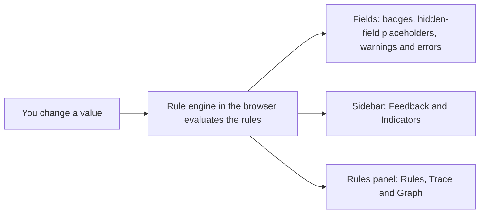
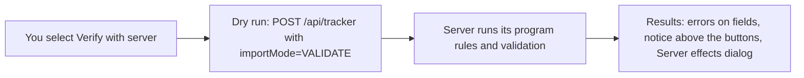

# How program rules are evaluated

## The short version

Program rules run in two places. The rule engine in your browser evaluates them every time a value in the form changes, and shows the result on the fields, in the sidebar and in the rules panel. The DHIS2 server evaluates them again in its tracker importer, which the app only reaches through **Verify with server**, a dry run that saves nothing.

## How it works

### In the browser

The app runs the DHIS2 rule engine (`@dhis2/rule-engine`) in your browser, through the `dhis2-form-utils` libraries. Each form has its own engine.

The engine evaluates the rules:

- Once when the form opens. The **Trace** tab shows this evaluation with the **Initial** tag, which marks any evaluation with no changed field.
- After every value change in the form. Changes are grouped: the engine waits about 40 ms after the last change, then evaluates once with all the fields that changed.
- After an **ASSIGN** action changes a value. The app writes the assigned value into the field, and that change causes another evaluation. Its **Trace** entry lists the assigned field under **Changed fields**.
- When the organisation unit or the date in the context bar changes, because both are passed to the form as values.
- In a tracker program, when a value changes in another form of the same enrollment. Each form shares its values with the other forms about 150 ms after you stop typing, and the forms that receive them evaluate their rules again. The **Trace** tab records this re-evaluation with the **Initial** tag, because no field changed in the form itself. If an **ASSIGN** action then changes a value, a second entry that names the assigned field follows.

Which rules each form evaluates:

- An event program form, or a stage form in a tracker program, evaluates the rules that have no program stage, plus the rules of its own stage.
- The **Enrollment form** evaluates only the rules that have no program stage.

The engine returns a list of effects. The app applies them right away:

- Field effects (hide, show, assign, mandatory, warning, error, options) change the field and add an effect badge.
- **HIDESECTION** effects replace the section body with a hidden-field placeholder.
- **DISPLAYTEXT** and **DISPLAYKEYVALUEPAIR** effects go to the **Feedback** and **Indicators** sidebar.
- Every evaluation is added to the **Trace** tab, and the latest one drives the **Rules** tab statuses and the **Graph** tab.
- Actions that only the server performs (**SENDMESSAGE**, **SCHEDULEMESSAGE**, **SCHEDULEEVENT**, **CREATEEVENT**) are not executed. They appear in the trace and in the **Server effects** dialog as simulated rows.

**Preview on-complete effects** runs one extra pass, the completion pass. The app sets the form status to `COMPLETED`, waits for the engine to evaluate again, and lists the on-complete warnings, errors and empty required fields it finds. See [Test on-complete rules](../using-the-app/test-on-complete-rules.md).

### On the server

The DHIS2 server evaluates program rules in its tracker importer when data is imported. The app never imports data. **Verify with server** sends the form to `POST /api/tracker?importMode=VALIDATE&async=false`. With `importMode=VALIDATE` the importer runs its validation and its program rules, reports what it found, and saves nothing.

The app then reads the report:

- Errors and warnings that a program rule produced are matched to the rule. Errors on a field that is on screen are shown on that field.
- Anything else is listed in the notice above the form buttons, and other import errors are listed under **Other import errors**.
- The server results also feed the **Server effects** dialog, where rows the browser and the server both produced are tagged **Server-verified** and rows only the server reported are tagged **Server only**.

Only **Verify with server** contacts the importer, and it is the only action that needs an organisation unit. **Validate form**, **Preview server effects** and **Preview on-complete effects** work in the browser only.

## Why it matters

- What you see while you type is the browser engine's result. It is fast and covers every rule, but it is not the server's answer.
- **Verify with server** is how you check that the server agrees. The two can disagree, for reasons explained in [Why client and server results differ](./why-client-and-server-results-differ.md).
- Because the engine runs on every change, the **Trace** tab can show you the exact change that made a rule fire or stop firing.

## Related pages

- [Rule inputs](./rule-inputs.md)
- [Why client and server results differ](./why-client-and-server-results-differ.md)
- [Find out why a rule did or didn't fire](../using-the-app/find-out-why-a-rule-did-or-didnt-fire.md)
- [Check rules against the server](../using-the-app/check-rules-against-the-server.md)
- [Is it safe on production?](../introduction/is-it-safe-on-production.md)
