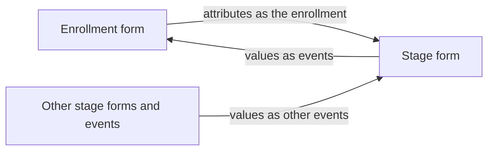

# Rule inputs

## The short version

A program rule can only react to what the rule engine is given. The app gives it the values in the form you have open, and in a tracker program also the values from the enrollment and from the other stage forms. It adds your user groups and roles, the program's constants, the selected organisation unit, the dates from the context bar and the event status. If a rule depends on something that is not in this list, it evaluates as if that value were empty.

## How it works

### Values in the form

Every field in the form you have open is an input, whether you typed the value or a rule assigned it. The engine evaluates again after each change, see [How program rules are evaluated](./how-program-rules-are-evaluated.md).

### Values from other forms (tracker programs)

In a tracker program all forms of the enrollment stay open in the background, so the values you entered in one form are available to the rules in the others:

- A stage form receives the values of the **Enrollment form** as the enrollment, so rules that read tracked entity attributes (`A{...}`) work in stage forms.
- A stage form also receives the values of every other stage form and event in the rail as the enrollment's other events. Its own values are not repeated in that list. This is what feeds program rule variables with the source types `DATAELEMENT_PREVIOUS_EVENT`, `DATAELEMENT_NEWEST_EVENT_PROGRAM` and `DATAELEMENT_NEWEST_EVENT_PROGRAM_STAGE`.
- The **Enrollment form** receives the values of all stage forms and events as the enrollment's events.

Values from other forms arrive about 150 ms after you stop typing. Every non-repeatable stage in the rail, and every event you add to a repeatable stage with **Add event**, counts as an event as soon as it exists, even if you have not entered anything in it yet.

### User groups and roles

When a program opens, the app reads your user groups and user roles from `/api/me` and passes their IDs to the engine. Rules that use `d2:inUserGroup` or `d2:hasUserRole` evaluate against your own account, not against the users who enter data in production. Test with an account that has the groups or roles you want to check.

The app does not pass organisation unit group memberships, so `d2:inOrgUnitGroup` has nothing to match against and always returns false in the app.

### Option groups

If a rule action uses **HIDEOPTIONGROUP** or **SHOWOPTIONGROUP**, the app fetches those option groups from `/api/optionGroups` to know which options they contain. If you cannot read an option group, those actions are expected to hide or show nothing, without a message. `TODO(verify)`: this case has not been tested.

### Constants

The app loads every constant in the instance (`/api/constants`, ID and value) and passes them to the engine, so `C{...}` in a condition or expression resolves.

### Organisation unit

The organisation unit you select in the context bar is the event's organisation unit, and in a tracker program the enrollment's. Until you select one, the engine evaluates without an organisation unit. Its code is not passed, so `V{orgunit_code}` is empty.

### Dates

| Form | Date the engine uses |
| --- | --- |
| Event program form | The **Event date** from the context bar, as the event date. |
| **Enrollment form** | The **Enrollment date** from the context bar, as the enrollment date. The incident date is the **Incident date** field when the program shows one, otherwise the enrollment date. |
| Tracker stage form or event | Today. Each event gets today's date when it is first shown and keeps it, and stage forms have no date field. |

Because all events in a tracker program share today's date, rules that compare events by date, such as rules on the previous event, depend on an order the app does not control.

### Event status

The event you have open has the status `ACTIVE`. **Preview on-complete effects** sets it to `COMPLETED` for the completion pass, so the engine evaluates the on-complete rules, and **Back to editing** or closing the **Server effects** dialog sets it back to `ACTIVE`. The other events of an enrollment are always `ACTIVE`, and the enrollment itself is always active.

### What the server receives

**Verify with server** sends a different set of inputs: the payload a save would send, without the values of fields a rule hid. See [Why client and server results differ](./why-client-and-server-results-differ.md).

## Why it matters

- When a rule does not fire, check its inputs first. The **Trace** tab shows which fields changed in each evaluation, and the rule details show the variables the condition reads.
- To test a rule that reads values from another stage, enter those values in the other stage form first, then come back.
- To test rules on user groups or roles, log in as a user who has them.

## Related pages

- [How program rules are evaluated](./how-program-rules-are-evaluated.md)
- [Set the organisation unit and date](../using-the-app/set-the-org-unit-and-date.md)
- [Work with repeatable stages](../using-the-app/work-with-repeatable-stages.md)
- [Test on-complete rules](../using-the-app/test-on-complete-rules.md)
- [Find out why a rule did or didn't fire](../using-the-app/find-out-why-a-rule-did-or-didnt-fire.md)
