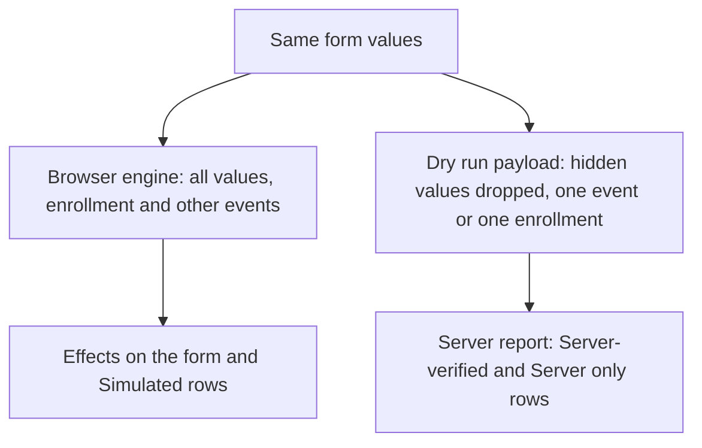

# Why client and server results differ

## The short version

The browser and the server run program rules separately, and they do not always see the same thing. Some actions only the server can perform, some only run on newer DHIS2 versions, the dry run does not report notifications, and **Verify with server** sends the server a narrower set of inputs than the browser engine uses. When the results differ, it is usually one of these reasons, not a broken rule.

## How it works

### Actions only the server runs

The browser engine does not execute **SENDMESSAGE**, **SCHEDULEMESSAGE**, **SCHEDULEEVENT** or **CREATEEVENT**. When one of these rules fires, the app records the effect in the trace and shows it in the **Server effects** dialog, but nothing is sent or created. Open the dialog with **Preview server effects** or **Preview on-complete effects** to see what the server would do.

The other way round, the server can report a rule effect the browser did not produce. The **Server effects** dialog tags such a row **Server only**.

### Version gates

The server only executes an action type if your DHIS2 version supports it. The app reads the version of the instance and compares:

| Action type | Executed by the server |
| --- | --- |
| **SENDMESSAGE**, **SCHEDULEMESSAGE**, **ASSIGN**, **SETMANDATORYFIELD**, **SHOWERROR**, **SHOWWARNING**, **ERRORONCOMPLETE**, **WARNINGONCOMPLETE** | From DHIS2 2.40 |
| **SCHEDULEEVENT** | From DHIS2 2.43 |
| **CREATEEVENT** | Not executed |

In the **Server effects** dialog, a row for an action your server does not execute is dashed and dimmed, with the note "Not executed by this server (requires 2.43)" or "Not executed by this server". The row is there for reference only.

:::note

If the app cannot read the server version, it treats the server as DHIS2 2.40.

:::

### Notifications stay Simulated

The dry run does not report notifications. **SENDMESSAGE** and **SCHEDULEMESSAGE** rows in the **Server effects** dialog keep the **Simulated** tag even after **Verify with server**, and the dialog footer says so. A **Simulated** notification row means the browser engine fired the rule. It does not confirm that the server would send the message.

Rule errors and warnings, mandatory fields and assignments do come back from the dry run. When the browser and the server both produced the same effect for the same rule, the row is tagged **Server-verified**. See the [provenance tags](../reference/provenance-tags.md).

### Different inputs

**Verify with server** sends exactly what a save would send. That is not the same as what the browser engine evaluates:

- **Values of hidden fields are left out.** The payload drops the values of fields a rule hid, and empty values. A server rule that reads a hidden field does not see its value.
- **A stage form sends its event on its own.** In a tracker program, verifying a stage form sends that one event, without its enrollment, tracked entity or the other events. In the browser the same form sees the enrollment's attributes and the other events. The server can also reject the bare event with errors that are not about rules, listed under **Other import errors**. `TODO(verify)`: the exact server response for a stage event sent this way.
- **The Enrollment form sends no events.** Verifying the **Enrollment form** sends the tracked entity and its enrollment only. The server sees no event values in this case.
- **Stage events are dated today.** Every event in a tracker program gets today's date, whatever the **Enrollment date** in the context bar says. Rules that use event dates, or that compare one event with the previous one, can behave differently from real data entry.
- **Your account is the user.** In the browser, rules on user groups or roles evaluate against the account you are logged in with. In a dry run, DHIS2 is expected to evaluate them against the importing user, which is the same account. This has not been checked.

See [Rule inputs](./rule-inputs.md) for the full list of what the browser engine uses.

### "Out of scope" rules that still fire

This difference is inside the browser, but it often looks like a mismatch. In a tracker program, a rule with no program stage is evaluated in every stage form, and it can fire there. The **Rules** tab of a stage form still labels it **Out of scope**, because its scope is the enrollment, and the "firing" count in the panel header leaves it out. Switch the panel to **All** to see it, and check the field badges and the **Trace** tab for its effects.

## Why it matters

- Treat the browser result as the answer to "what does this rule do with these values". Treat **Verify with server** as the answer to "would the server accept this payload".
- When a row says **Server only**, the server evaluated something the browser did not. Check the inputs above before you change the rule.
- When a notification or scheduled event matters, check its row in the **Server effects** dialog and remember that the dry run cannot confirm it.

## Related pages

- [How program rules are evaluated](./how-program-rules-are-evaluated.md)
- [Rule inputs](./rule-inputs.md)
- [Check rules against the server](../using-the-app/check-rules-against-the-server.md)
- [Preview server effects](../using-the-app/preview-server-effects.md)
- [Provenance tags](../reference/provenance-tags.md)
- [DHIS2 version compatibility](../introduction/dhis2-version-compatibility.md)
