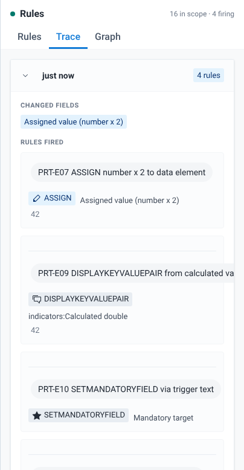

# Tutorial: debug your first event program rule

In this tutorial you open an event program, change a value, and follow the result back to the program rule that caused it. Then you make an idle rule fire and see why it didn't fire before.

## What you will learn

- How to open a program and set the organisation unit and date.
- How to read an effect badge on a field.
- How to find the rule behind a badge on the **Rules** tab, and follow each evaluation on the **Trace** tab.

## Before you start

- The app is installed and you can open it. See [Install](./install.md) and [Requirements and user authorities](./requirements-and-user-authorities.md).
- This tutorial uses the PRT event program from the Program Rules Playground test metadata. Its name starts with "PRT" and ends with "Event Program Rules Test". If your server has an equivalent program, you can follow along with it. `TODO(verify)`: where to download the PRT test metadata package.
- The program is assigned to the organisation unit **Ngelehun CHC** (Sierra Leone, Bo, Badjia). On your server, use any organisation unit assigned to the program.

## Step 1: open the program

1. Open **Program Rules Playground** from the DHIS2 apps menu. The **Programs** list opens.
2. In the search field, type `PRT`.
3. Select **Event** to show event programs only.
4. Select the PRT event program row.

The playground opens. The context bar at the top shows the program name, "Event program · 16 rules", the **Organisation unit** and **Event date** fields, and **Reset playground**. Below it is the event form, with the **Feedback** and **Indicators** cards and the rules panel on the right.

## Step 2: set the organisation unit and date

1. Next to **Organisation unit**, select **Select**. The **Select organisation unit** dialog opens.
2. Expand **Sierra Leone**, **Bo** and **Badjia**, then select **Ngelehun CHC**. Bo and Badjia are greyed out because they are not assigned to the program, so you can't select them.
3. Select **Select Ngelehun CHC**.
4. Leave **Event date** on today's date.

Only **Verify with server** needs an organisation unit. The rules in this tutorial run without one, but setting it now means you can check your results against the server later.

## Step 3: change a value and read the badge

1. In **Main Section**, type `21` in **Number input**, then move to the next field.
2. Look at **Assigned value (number x 2)**. It now shows `42`, the field is disabled, and its label has an **Assigned** badge.
3. Point at the **Assigned** badge. The tooltip names the action type and the rule, "ASSIGN from rule: PRT-E07 ASSIGN number x 2 to data element".
4. Look at the **Indicators** card. It lists **Calculated double** with the value `42`, produced by the rule "PRT-E09 DISPLAYKEYVALUEPAIR from calculated value".
5. Type `mandatory` in **Trigger text**, then move to the next field.
6. **Mandatory target** now has an asterisk and a **Required by rule** badge. The **Feedback** card lists "Trigger text is:" with the value `mandatory`.

Each badge shows the last effect a rule had on that field. See [Effect badges legend](../reference/effect-badges-legend.md) for every badge.

## Step 4: find the rule on the Rules tab

The rules panel opens on the **Rules** tab.

1. Read the header. It shows "16 in scope" and the number of rules that are firing. In an event program every rule is in scope, so there is no **In scope** / **All** switch.
2. Find the card for **PRT-E07 ASSIGN number x 2 to data element**. Its status is **Firing**, and firing rules are sorted to the top.
3. Read the card. It shows the rule's action as "ASSIGN" with its target, **Assigned value (number x 2)**, and the condition `d2:hasValue('prt_number')`. The condition is true because **Number input** has a value.
4. Select **Program rule details** (the info button on the card) to see the full rule, including a plain-language reading of the condition. Select **Close** when you are done.

If you select the card itself, the panel highlights the rule and switches to the **Graph** tab. Select **Rules** to come back.

## Step 5: follow the evaluations on the Trace tab

1. Select the **Trace** tab.
2. The newest evaluation is at the top and is expanded. Its **Changed fields** list shows the field you changed last, **Trigger text**. If your last change made a rule assign a new value, the newest entry is the evaluation that the assignment caused, and its **Changed fields** list shows the assigned field, such as **Assigned value (number x 2)**. In that case, look one entry down.
3. Under **Rules fired**, find the rules that produced effects in that evaluation, with each effect and its target.
4. Look at the older entries below it. Each one shows how long ago it ran and a tag with the number of rules. Select the arrow next to an entry (its label is "Expand evaluation details") to expand it, and find the one that lists **Number input** under **Changed fields**.

In the screenshot, the newest entry lists **Assigned value (number x 2)** under **Changed fields**. That is the evaluation caused by PRT-E07 writing its value into the field, right after a change to **Number input**.

The oldest entry, at the bottom and tagged **Initial**, is the evaluation when the form loaded, before you changed anything. The tag marks any evaluation with no changed field.

## Step 6: make an idle rule fire

Now look at a rule that did not fire.

1. Select the **Rules** tab. Find **PRT-E03 SHOWWARNING when number > 100**. Its status is **Idle**.
2. Read its condition: `d2:hasValue('prt_number') && #{prt_number} > 100`. **Number input** is `21`, which is not more than 100, so the condition is false and the rule does nothing.
3. Change **Number input** to `150` and move to the next field.
4. **Number input** now has a **Warning** badge and the warning text "Number exceeds 100:". **Assigned value (number x 2)** changes to `300`.
5. On the **Rules** tab, **PRT-E03 SHOWWARNING when number > 100** is now **Firing** and has moved to the top.
6. On the **Trace** tab, the newest entry lists **Assigned value (number x 2)** under **Changed fields**. It is the evaluation caused by PRT-E07 assigning `300`. The entry below it lists **Number input** under **Changed fields** and PRT-E03 under **Rules fired**.

The warning text shows only the action's text, not the value. The app does not add the value after "Number exceeds 100:".

## What you did

You changed values in an event form and followed each effect back to its rule. The badge and its tooltip told you which rule changed the field. The **Rules** tab showed which rules are firing and their conditions, so you could see why PRT-E03 stayed idle at `21` and fired at `150`. The **Trace** tab showed which field change triggered which rules.

Nothing you typed was saved. Select **Reset playground** to clear the form and start again.

## Next steps

- [Find out why a rule did or didn't fire](../using-the-app/find-out-why-a-rule-did-or-didnt-fire.md)
- [Map rule dependencies](../using-the-app/map-rule-dependencies.md)
- [Check rules against the server](../using-the-app/check-rules-against-the-server.md)
- [Test on-complete rules](../using-the-app/test-on-complete-rules.md)
- [Tutorial: tracker rules across enrollment and events](./tutorial-tracker-rules-across-enrollment-and-events.md)
