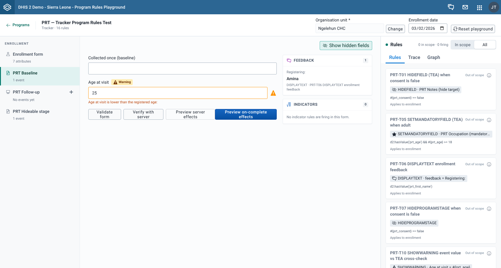

# Tutorial: tracker rules across enrollment and events

In a tracker program, rules can read values from more than one form. In this tutorial you enter an attribute in the enrollment form and watch a rule in a stage form react to it. Then you add two events to a repeatable stage and test an on-complete rule in one of them.

## What you will learn

- How the **Enrollment** rail switches between the enrollment form and the stage forms without losing your input.
- How a value in the **Enrollment form** drives a rule in a stage form, and why the **Rules** tab marks that rule **Out of scope** there.
- How to add events to a repeatable stage and test each event on its own.

## Before you start

- Do [Tutorial: debug your first event program rule](./tutorial-debug-your-first-event-program-rule.md) first. This tutorial assumes you know the badges and the **Rules** and **Trace** tabs.
- This tutorial uses the PRT tracker program from the Program Rules Playground test metadata. Its name starts with "PRT" and ends with "Tracker Program Rules Test". If your server has an equivalent program, you can follow along with it. `TODO(verify)`: where to download the PRT test metadata package.
- The program is assigned to the organisation unit **Ngelehun CHC** (Sierra Leone, Bo, Badjia). On your server, use any organisation unit assigned to the program.

`TODO(verify)`: the steps on this page come from the app's code and the program's metadata. Steps 2, 3 and 5 match the screenshots, which were captured in a browser. Steps 4 and 6 have not been run in a browser yet.

## Step 1: open the program and set the organisation unit

1. Open **Program Rules Playground**. In the **Programs** list, select **Tracker** to show tracker programs only.
2. Select the PRT tracker program row. You can also type `PRT` in the search field to narrow the list.
3. Next to **Organisation unit**, select **Select**, expand **Sierra Leone**, **Bo** and **Badjia**, select **Ngelehun CHC**, then select **Select Ngelehun CHC**.
4. Leave **Enrollment date** on today's date.

The context bar shows "Tracker · 16 rules". On the left is the **Enrollment** rail. Its first row, **Enrollment form**, is selected, and the stages are listed below it: **PRT Baseline**, **PRT Follow-up** and **PRT Hideable stage**.

## Step 2: fill in the enrollment form

1. In the **PRT Identification** section, type `Amina` in **First name**.
2. Type `30` in **Age (years)**, then move to the next field.

What you see:

- In **PRT Rule targets**, **Risk score (assign target)** shows `3`, is disabled and has an **Assigned** badge. The rule "PRT-T04 ASSIGN risk score (TEA) from age" divides the age by 10.
- **Occupation (mandatory target)** has an asterisk and a **Required by rule** badge, from "PRT-T05 SETMANDATORYFIELD (TEA) when adult", because the age is 18 or more.
- The **Feedback** card lists "Registering:" with the value `Amina`, from "PRT-T06 DISPLAYTEXT enrollment feedback".

## Step 3: watch a stage rule react to the enrollment form

The rule "PRT-T10 SHOWWARNING event value vs TEA cross-check" compares a value in the **PRT Baseline** stage with the age you entered in the enrollment form. Its condition is `d2:hasValue('prt_age_at_visit') && d2:hasValue('prt_age') && #{prt_age_at_visit} < #{prt_age}`.

1. In the rail, select **PRT Baseline**.
2. Type `25` in **Age at visit**, then move to the next field.

**Age at visit** now has a **Warning** badge and the warning text "Age at visit is lower than the registered age:".

This works because each form shares its values with the others as you type. Stage forms see the attributes from the **Enrollment form**, and the **Enrollment form** sees the values in every event.

Now try it the other way round:

1. In the rail, select **Enrollment form** and change **Age (years)** to `20`.
2. Select **PRT Baseline** again. The warning is gone, because 25 is not lower than 20. The stage form re-evaluates its rules whenever an enrollment value changes, even if you don't touch the stage form.

Switching rows in the rail never loses your input. Every form stays loaded in the background.

## Step 4: find the rule in the stage form's Rules tab

Each form has its own rules panel. Look at the one next to the **PRT Baseline** form.

1. Change **Age (years)** in the **Enrollment form** back to `30`, then select **PRT Baseline** again. The warning is back.
2. In the rules panel, look at the header. In a tracker program it has an **In scope** / **All** switch, and **In scope** is selected.
3. Under **In scope**, the **Rules** tab lists only the rules that belong to the **PRT Baseline** stage. This program has none, so the tab reads "No program rules match this view."
4. Select **All**. Find **PRT-T10 SHOWWARNING event value vs TEA cross-check**. Its status is **Out of scope** and its caption reads "Applies to enrollment".
5. Select the **Trace** tab. The newest entry is tagged **Initial**, because the stage form re-evaluated its rules when you changed **Age (years)** in the **Enrollment form**. It reads "effects on load" with the number of effects, and lists PRT-T10. Further down, the entry from step 3 lists **Age at visit** under **Changed fields** and PRT-T10 under **Rules fired**.

The rule fired in this form, but the **Rules** tab marks it **Out of scope**. The app treats a rule with no program stage as belonging to the enrollment form, and a rule with a program stage as belonging to that stage only. The header's firing count only counts rules in scope, so it does not include PRT-T10 here. The **Trace** tab shows every rule that fired in the form, in scope or not.

## Step 5: add two events to a repeatable stage

**PRT Follow-up** is a repeatable stage. Its rail row reads "No events yet".

1. On the **PRT Follow-up** row, select **Add event** (the plus button). A row **Event 1** appears under the stage and opens. The stage row now reads "1 event".
2. Type `70` in **Weight (kg)**, then move to the next field. The **Indicators** card lists **Current weight (kg)** with the value `70`.
3. Select **Add event** again. **Event 2** appears and opens, and the stage row reads "2 events".
4. Type `999` in **Weight (kg)**, then move to the next field.

In **Event 2**:

- **Weight (kg)** has an **On complete: error** badge, from "PRT-T14 ERRORONCOMPLETE when weight == 999".
- The **Indicators** card lists **Current weight (kg)** with the value `999`.

Select **Event 1** in the rail. **Weight (kg)** still shows `70`. You may also see a warning from "PRT-T09 SHOWWARNING weight below previous event" on **Event 1**, because both events have the same date and the rule can treat **Event 2** as the previous event. See the note in step 6. Each event has its own form, its own **Feedback** and **Indicators** cards and its own rules panel.

You can't remove an event once you add it. To start over, select **Reset playground**, which clears all forms.

## Step 6: test the on-complete rule in one event

1. Select **Event 2** in the rail.
2. Select **Preview on-complete effects**.
3. A banner titled "Cannot complete this event yet" appears above the buttons. It lists "Error: Weight (kg) – 999 is a test sentinel and blocks completion".
4. Select **Back to editing**.

Change **Weight (kg)** to `998` and try again. The banner is now titled "Review before completing", from "PRT-T15 WARNINGONCOMPLETE when weight == 998", and offers **Complete anyway** as well as **Back to editing**.

:::note Rules that compare with the previous event

Every event you add gets today's date, and stage forms have no event date field. Rules that compare an event with the previous one, such as "PRT-T09 SHOWWARNING weight below previous event", depend on the order of event dates, so their results are not reliable when all events have the same date.

:::

## What you did

You entered attributes in the **Enrollment form** and saw a rule in the **PRT Baseline** stage form react to them, because the forms share their values. You saw that the **Rules** tab marks a rule without a program stage as **Out of scope** in a stage form, even when it fires there, and that the **Trace** tab shows it anyway. Then you added two events to a repeatable stage, saw that each keeps its own values, and tested an on-complete rule in one of them.

Nothing you typed was saved.

## Next steps

- [Work with repeatable stages](../using-the-app/work-with-repeatable-stages.md)
- [Test on-complete rules](../using-the-app/test-on-complete-rules.md)
- [Rule inputs](../concepts/rule-inputs.md)
- [Find out why a rule did or didn't fire](../using-the-app/find-out-why-a-rule-did-or-didnt-fire.md)
- [Preview server effects](../using-the-app/preview-server-effects.md)
