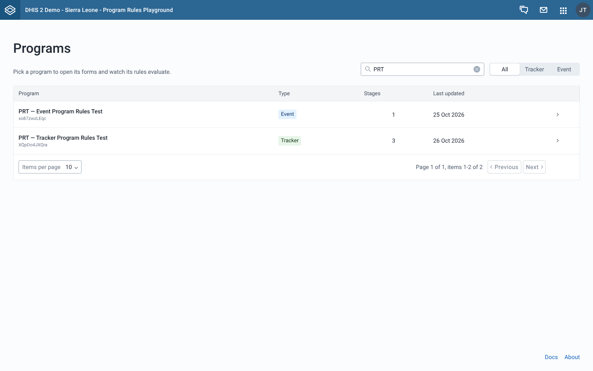
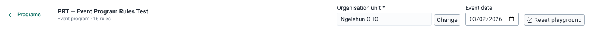
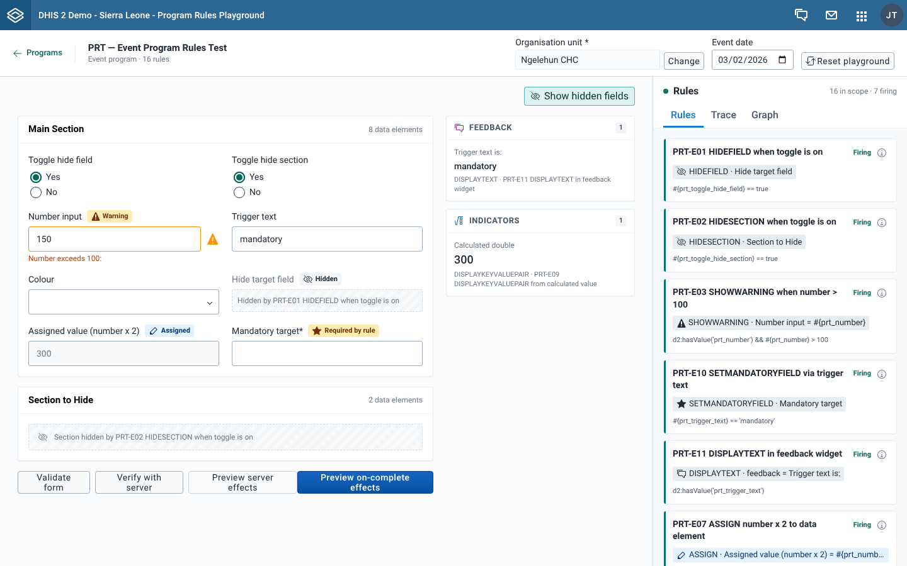
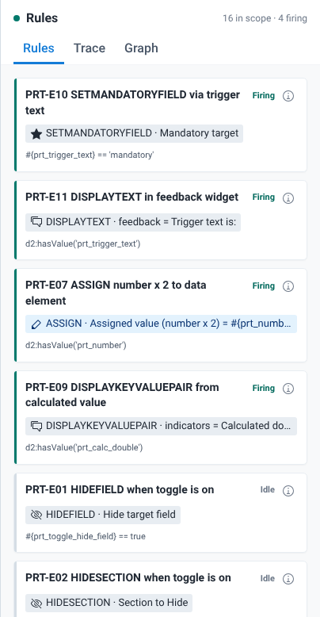
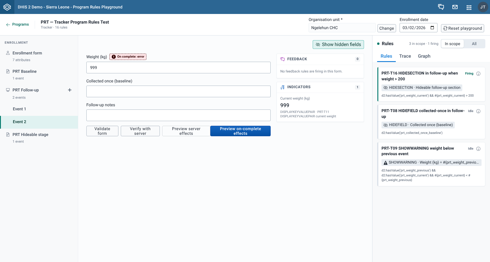

# Screens and controls

This page goes through the app screen by screen. For each screenshot, the numbered list names the controls you can see, from top left to bottom right, and links to the page that explains how to use them.

The app has three screens: the program list, the playground for one program, and the About page.

## Program list

The first screen when you open the app. It lists the programs you can see.

1. **Programs** heading, with "Pick a program to open its forms and watch its rules evaluate." under it.
2. Search field, "Search by name, code, or ID". It filters the list as you type. See [Find and open a program](../using-the-app/find-and-open-a-program.md).
3. Type switch, **All**, **Tracker** or **Event**.
4. Program table, with the columns **Program** (name and ID), **Type**, **Stages** and **Last updated**. Select a row to open the program in the playground.
5. Page controls under the table, to move between pages and change how many programs show per page. The default is 10.
6. **Docs** and **About** links at the bottom right. **Docs** opens this site in a new tab. **About** opens the About page.

## Playground

The screen for one program. It has the context bar at the top, then the form area. In a tracker program, the **Enrollment** rail sits on the left of the form.

### Context bar

1. **Programs** back link. It returns to the program list, with your search, type and page as you left them. See [Find and open a program](../using-the-app/find-and-open-a-program.md).
2. Program name, with the program type (**Tracker** or **Event program**) and the number of rules under it.
3. **Organisation unit**, with **Select** (or **Change** once one is set). It opens the **Select organisation unit** dialog. Only **Verify with server** needs an organisation unit. See [Set the organisation unit and date](../using-the-app/set-the-org-unit-and-date.md).
4. **Event date** in an event program, or **Enrollment date** in a tracker program. It defaults to today. See [Set the organisation unit and date](../using-the-app/set-the-org-unit-and-date.md).
5. **Reset playground**. It clears the organisation unit, sets the date back to today and empties every form. See [Start over](../using-the-app/start-over.md).

### Form

1. **Show hidden fields**, at the top right of the fields. When it is on (teal), a placeholder marks each field or section a rule hid. When it is off (grey), they are left out. See [Read field badges and hidden-field placeholders](../using-the-app/read-field-badges-and-hidden-field-placeholders.md).
2. Section cards, each with the section name and the number of fields in it.
3. Effect badges next to field labels, such as **Hidden**, **Warning**, **Assigned** and **Required by rule**. See the [Effect badges legend](./effect-badges-legend.md).
4. Hidden-field placeholder, "Hidden by" followed by the rule name, or "Section hidden by" for a whole section.
5. **Feedback** and **Indicators** cards, to the right of the fields. See [Read the Feedback and Indicators sidebar](../using-the-app/read-the-feedback-and-indicators-sidebar.md).
6. Form buttons, under the fields:
   - **Validate form**. See [Validate a form](../using-the-app/validate-a-form.md).
   - **Verify with server**. See [Check rules against the server](../using-the-app/check-rules-against-the-server.md).
   - **Preview server effects**. See [Preview server effects](../using-the-app/preview-server-effects.md).
   - **Preview on-complete effects**, on event forms only. See [Test on-complete rules](../using-the-app/test-on-complete-rules.md).
7. Rules panel, docked on the right. See the next section.

The Enrollment form of a tracker program has **Validate form**, **Verify with server** and **Preview server effects** only.

### Rules panel

1. **Rules** title, with the counter "n in scope · n firing".
2. **In scope** / **All** switch. It only shows in tracker programs. In an event program every rule is in scope.
3. Tabs: **Rules**, **Trace** and **Graph**.
4. Rule cards, firing rules first. Each card shows:
   - the rule name and its status, **Firing**, **Idle** or **Out of scope**
   - an info button, **Program rule details**, that opens the rule's details. See [Open and edit a rule](../using-the-app/open-and-edit-a-rule.md).
   - one effect badge per action, such as "ASSIGN · Assigned value (number x 2)"
   - the rule condition
   - for an out-of-scope rule, where it applies: "Applies to enrollment" or "Applies to" followed by a stage name

Selecting a card highlights the rule and switches to the **Graph** tab. See [Find out why a rule did or didn't fire](../using-the-app/find-out-why-a-rule-did-or-didnt-fire.md) for the **Rules** and **Trace** tabs, and [Map rule dependencies](../using-the-app/map-rule-dependencies.md) for the **Graph** tab.

### Enrollment rail

In a tracker program, the **Enrollment** rail on the left lists the forms of one enrollment.

1. **Enrollment** heading.
2. **Enrollment form**, with the number of attributes. It is selected when you open the program.
3. One row per program stage. A stage that is not repeatable shows "1 event".
4. A repeatable stage shows "No events yet", "1 event" or "n events", and an **Add event** button.
5. The events you added, as "Event 1", "Event 2" and so on, under their stage.

Switching rows keeps what you entered in every form. See [Work with repeatable stages](../using-the-app/work-with-repeatable-stages.md).

## Dialogs

| Dialog | Opened from | See |
| --- | --- | --- |
| **Select organisation unit** | **Select** or **Change** in the context bar | [Set the organisation unit and date](../using-the-app/set-the-org-unit-and-date.md) |
| Program rule details | **Program rule details** on a rule card, or a rule name in **Server effects** | [Open and edit a rule](../using-the-app/open-and-edit-a-rule.md) |
| **Server effects** | **Preview server effects** or **Preview on-complete effects** | [Preview server effects](../using-the-app/preview-server-effects.md) |
| **Rule dependency graph** | The full-screen button on the **Graph** tab | [Map rule dependencies](../using-the-app/map-rule-dependencies.md) |

## About page

Open it from **About** at the bottom of the program list. It shows the app **Version**, the **Supported DHIS2** versions and a **Resources** list: **Documentation**, **GitHub repository**, **Report a bug** and **dhis2-form-utils**. Each resource opens in a new tab. **← Back to programs** returns to the program list, without your earlier search.

## Related pages

- [Glossary](./glossary.md)
- [Messages and errors](./messages-and-errors.md)
- [Effect badges legend](./effect-badges-legend.md)
