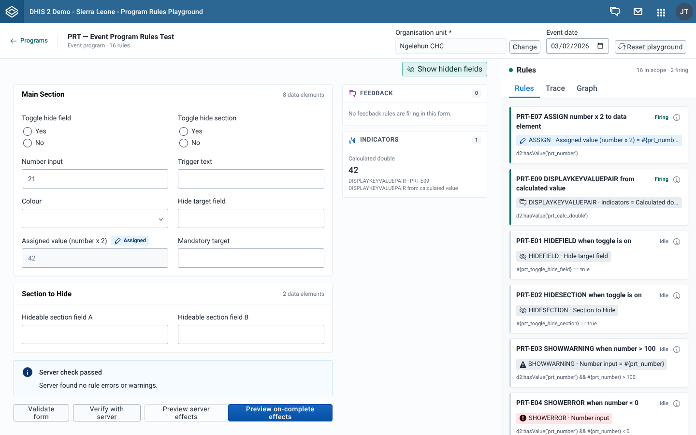

# Check rules against the server

## Goal

Find out what your DHIS2 server says about the values in a form. **Verify with server** sends the form to the server as a dry run. The server runs its own program rules and validation, reports what it found, and saves nothing.

Use it when you want to compare what the server reports with what the playground shows.

## Before you start

- Select an **Organisation unit** in the context bar. **Verify with server** is the only form action that needs one. See [Set the organisation unit and date](./set-the-org-unit-and-date.md).
- Make sure your user can capture data for the program in that organisation unit. The server checks your sharing and capture scope during the dry run. See [Requirements and user authorities](../getting-started/requirements-and-user-authorities.md).

## Steps

1. Fill in the form.
2. Select **Verify with server**. The button shows a spinner while the server works.
3. Read the notice above the form buttons, and look for errors on the fields.
4. Change values and select **Verify with server** again to run a new check. There is no automatic retry.

## What you'll see

### The notice

| Notice | What it means |
| --- | --- |
| **Server check passed**, "Server found no rule errors or warnings." | The dry run returned no rule errors, no rule warnings and no other import errors. |
| **Server check found issues**, "The affected fields are highlighted in the form." | The server raised rule errors, and each one is shown on the field it targets. |
| **Server check found issues**, with a list | Some results could not be shown on a field: warnings, results with no target field, or results for a field that isn't on screen. Each line shows the field name (a link that jumps to the field) and the server's message. |
| **Other import errors (n)** | Shown inside **Server check found issues** when the server rejected the payload for reasons that are not program rules, such as sharing, capture scope or an invalid value. Each error shows its DHIS2 error code. |
| **Could not verify with server** | The dry run did not complete. The notice shows the DHIS2 error message, or "An unexpected error occurred". |

When the server returns no rule errors, you see **Server check passed**, even if the playground shows a rule error on a field. Finding differences like this is what **Verify with server** is for. See [Why client and server results differ](../concepts/why-client-and-server-results-differ.md).

### Rule errors on fields

When the server reports a rule error for a field that is on screen, the error appears on that field, like a field error. The next time you select **Verify with server**, the app clears these errors before it runs the new check.

The app recognises the server's rule messages for errors, warnings, mandatory fields, assigned values and scheduled events. An assigned value that the server would overwrite shows as "Assign overwrite" in the [Server effects](./preview-server-effects.md) dialog.

### Running it again

- While a new check runs, the old notice disappears.
- If the new check fails with **Could not verify with server**, the notice shows only the failure. Field errors from the earlier check are already cleared.
- The last result that completed is kept. The **Server effects** dialog keeps comparing against it, so its provenance tags don't reset when a retry fails.

### What the app sends

The app sends exactly the payload a save would send, as `POST /api/tracker?importMode=VALIDATE&async=false`. `importMode=VALIDATE` makes it a dry run: the server checks the payload and discards it. Fields hidden by a rule and empty fields are left out.

| Form | Payload |
| --- | --- |
| Event program form | One event: program, program stage, organisation unit, the **Event date** as the event date, status and data values. |
| Enrollment form | One tracked entity with its attributes and one enrollment (program, organisation unit, status `ACTIVE`, the **Enrollment date**, and the incident date when the program shows one). No events are sent. |
| Stage form in a tracker program | One event on its own, with no tracked entity or enrollment. The event date is today. |

`TODO(verify)`: how the server responds to the bare stage event. It may answer with **Other import errors** that are not about your rules.

The event status is `ACTIVE`. After you open the **Server effects** dialog for completion, through **Preview on-complete effects** or **Complete anyway**, the form sends `COMPLETED` with a completion date, so the server also runs its on-complete rules. Select **Preview server effects** to switch back to `ACTIVE`. See [Test on-complete rules](./test-on-complete-rules.md).

### Without an organisation unit

If you select **Verify with server** with no organisation unit, the **Organisation unit** field shows "Required to verify or save", and the notice shows **Could not verify with server** with "Select an organisation unit before saving or verifying". Select an organisation unit and try again. Nothing is saved, even though the messages say "save".

## Related pages

- [Preview server effects](./preview-server-effects.md)
- [Why client and server results differ](../concepts/why-client-and-server-results-differ.md)
- [Requirements and user authorities](../getting-started/requirements-and-user-authorities.md)
- [Messages and errors](../reference/messages-and-errors.md)
- [Troubleshooting and FAQ](../help/troubleshooting-and-faq.md)
