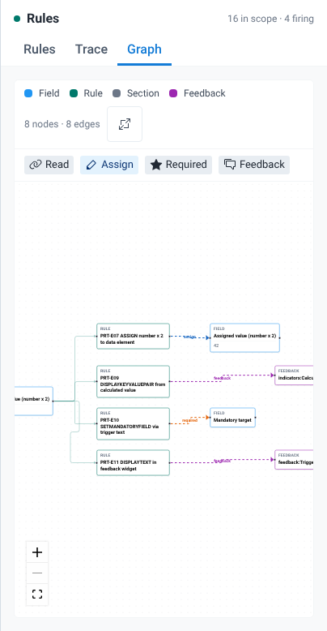
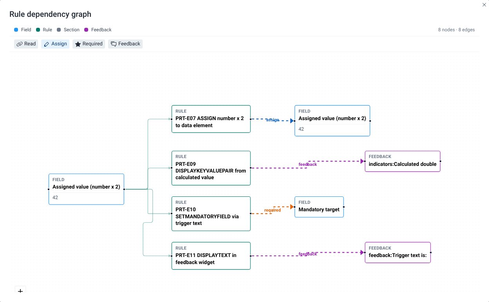

# Map rule dependencies

## Goal

See one rule evaluation as a graph: the fields you changed, the rules that fired, and the fields, sections and feedback items those rules affected. Use it to follow a chain of rules, for example an assignment that makes another rule fire.

## Before you start

- You have a program open in the playground. See [Find and open a program](./find-and-open-a-program.md).
- You have changed at least one value in the form. The graph only shows rules that fired.

## Steps

1. In the rules panel next to the form, select the **Graph** tab. It shows the latest evaluation.
2. To look at an earlier evaluation, select an entry in the **Trace** tab, then go back to **Graph**. To highlight one rule, select its card on the **Rules** tab or its name in a **Trace** entry. Both open the **Graph** tab. See [Find out why a rule did or didn't fire](./find-out-why-a-rule-did-or-didnt-fire.md).
3. Read the graph from left to right: field, then rule, then target.
4. Hover an edge to see its label if it isn't shown.
5. Use the zoom controls to zoom in and out. You can drag nodes to tidy the layout.
6. To see a large graph better, select the **Open graph in full screen** button (the full-screen icon) in the graph toolbar. The graph opens in a dialog titled **Rule dependency graph**. If you highlighted an evaluation or a rule, the dialog shows it under the title. Close the dialog to go back to the panel.

## What you'll see

### Nodes

The toolbar shows a colour swatch for each kind of node, and the number of nodes and edges, for example "6 nodes · 5 edges".

| Node | What it is |
| --- | --- |
| **Field** | A data element or attribute. It is either a field you changed in this evaluation or a field a rule acted on. A field node shows the field's current value, when it has one. |
| **Rule** | A program rule that fired in this evaluation. |
| **Section** | A section that a rule hid. |
| **Feedback** | A **Feedback** or **Indicators** item that a rule displayed. The node is labelled with the location and the item's static text, for example "indicators:Calculated double" or "feedback:Trigger text is:". |

### Edges

- An edge from a field to a rule is a read edge. It links the fields that changed in this evaluation to each rule that fired. If you changed a field and no rule fired, the graph shows only that field.
- An edge from a rule to a target is an effect edge. Its label and colour show the kind of effect, for example hide, assign or warning.

The read edge links every changed field to every rule that fired, whether or not the rule's condition uses that field. The changed fields include fields that a rule assigned. When an **ASSIGN** action changes a value, the form evaluates its rules again, and the graph of that evaluation shows the assigned field, for example **Assigned value (number x 2)**, as the only source field, linked to every rule that fired. To see which fields a rule actually reads, open its details and look at **Variables referenced**. See [Open and edit a rule](./open-and-edit-a-rule.md).

When the graph has more than four edges, the read edge labels are hidden. Hover an edge to show its label.

The toolbar also has a legend that lists the effect kinds that appear on the edges in the current graph, for example **Read**, **Hide**, **Assign** or **Required**. For the colours and icons, see the [Effect badges legend](../reference/effect-badges-legend.md).

### The empty graph

When the evaluation has nothing to show, for example right after the form loads with no rule firing, the **Graph** tab shows:

> **No rule relationships yet**
>
> Interact with the form to build the dependency graph. Only rules active in the latest evaluation are shown. Select a trace entry to inspect a past evaluation. Connections flow Field → Rule → Target (read / effect).

The full-screen button only appears when the graph has nodes.

## Related pages

- [Find out why a rule did or didn't fire](./find-out-why-a-rule-did-or-didnt-fire.md)
- [Effect badges legend](../reference/effect-badges-legend.md)
- [How program rules are evaluated](../concepts/how-program-rules-are-evaluated.md)
