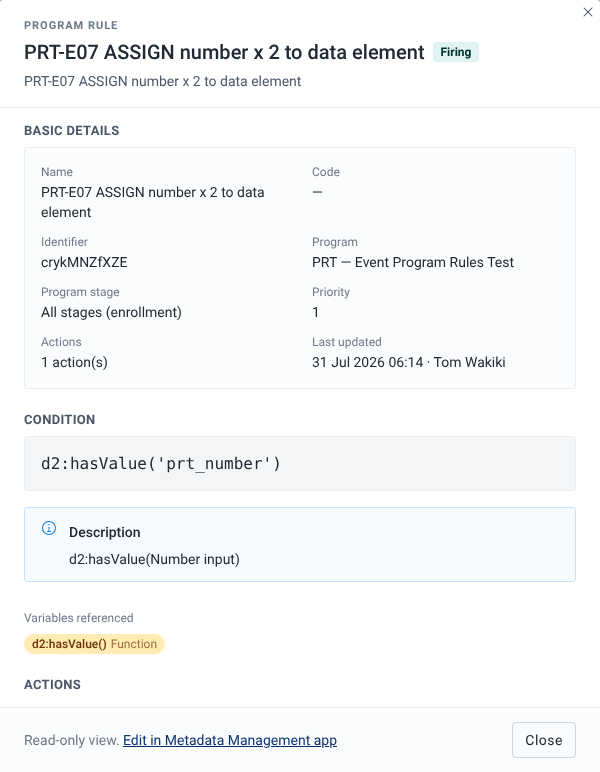

# Open and edit a rule

## Goal

Read the whole of a program rule, including its condition in plain language and every action, without leaving the playground. When you find a problem, open the rule in the DHIS2 app where you edit rules.

## Before you start

- You have a program open in the playground. See [Find and open a program](./find-and-open-a-program.md).
- To edit the rule, you need access to the rule editor app and the authorities to change program rules. See [Who can edit](#who-can-edit) below.

## Steps

1. In the rules panel, select the **Rules** tab and find the rule.
2. Select the **Program rule details** button (the info icon) on the rule card. You can also select a rule name in the **Server effects** dialog. See [Preview server effects](./preview-server-effects.md).
3. Read the dialog. Its sections are described below.
4. To change the rule, select **Edit in Maintenance app** or **Edit in Metadata Management app** at the bottom of the dialog. The rule opens in a new tab.
5. Select **Close** to go back to the form.

## What you'll see

### Header

The header shows "Program rule", the rule name, its status (**Firing**, **Idle** or **Out of scope**) and the rule description, if it has one. When you open the dialog from the **Server effects** dialog, the status is always **Firing**.

### Basic details

| Item | What it shows |
| --- | --- |
| **Name** | The rule name. |
| **Code** | The rule code. |
| **Identifier** | The rule ID. |
| **Program** | The program the rule belongs to. |
| **Program stage** | The stage the rule is limited to. A rule with no stage shows "All stages (enrollment)", in event programs too. |
| **Priority** | The rule priority. |
| **Actions** | The number of actions, for example "2 action(s)". |
| **Last updated** | The date and time of the last change, and who made it. |

A value that isn't set shows a dash.

### Condition

The **Condition** section shows the condition expression as it is written in the rule.

Under it, the app asks your DHIS2 server for a plain-language reading of the condition. While it waits, you see "Generating a plain-language description…". The reading then appears in a **Description** box. Fetching it saves nothing.

If the reading can't be loaded, a yellow warning starts with "Could not describe this expression:". It is followed by the reason the server gave, or by "Could not load a plain-language description for this condition. The raw expression is shown above." The condition expression is still shown.

**Variables referenced** lists each variable and function in the condition as a chip, with its kind:

- `#{...}`: **Data element**
- `A{...}`: **Tracked entity attribute**
- `V{...}`: **Environment variable**
- `d2:` functions: **Function**

Program rule variables are shown by name. When you open the dialog from the **Server effects** dialog, the chips show the raw expressions.

### Actions

One card per action, numbered **Action 1**, **Action 2** and so on, with the action type. Each card can show:

- The target, with its kind and ID, for example a **Data element**, **Tracked entity attribute**, **Program stage section**, **Program stage**, **Option** or **Option group**.
- **Data (expression)**: the expression the action evaluates.
- **Content (static text)**: the static text, for display actions.
- **Location**: where a display action shows its text.

If the rule can't be loaded, the dialog shows "Could not load this rule:" followed by the reason.

### The edit link

The dialog is a read-only view. The link at the bottom opens the rule in the app that edits program rules on your DHIS2 version.

:::note

On DHIS2 2.40 to 2.42, the link reads **Edit in Maintenance app** and opens the rule in the Maintenance app. On DHIS2 2.43, it reads **Edit in Metadata Management app** and opens the rule in Metadata Management.

:::

The app picks the link from the version your DHIS2 server reports. If it can't tell the version, it uses the Maintenance app link.

After you save a change in the other app, reload the playground page so it loads the changed rule.

### Who can edit

Anyone who can open the program can open the details dialog. No extra authority is needed.

To use the edit link, you need:

| DHIS2 version | To open the editor app | To edit the rule |
| --- | --- | --- |
| 2.40 to 2.42 | `M_dhis-web-maintenance` | `F_PROGRAM_RULE_ADD`, and `F_PROGRAM_RULE_DELETE` to delete rules, plus metadata write sharing on the program |
| 2.43 | `M_dhis-web-metadata-management` | The same as for 2.40 to 2.42 |

Without access to the editor app, the link opens a DHIS2 page that says "Unable to find an app for this URL." These authorities were checked on DHIS2 2.43 only. See [Requirements and user authorities](../getting-started/requirements-and-user-authorities.md).

## Related pages

- [Find out why a rule did or didn't fire](./find-out-why-a-rule-did-or-didnt-fire.md)
- [Rule action types](../reference/rule-action-types.md)
- [Requirements and user authorities](../getting-started/requirements-and-user-authorities.md)
- [DHIS2 version compatibility](../introduction/dhis2-version-compatibility.md)
