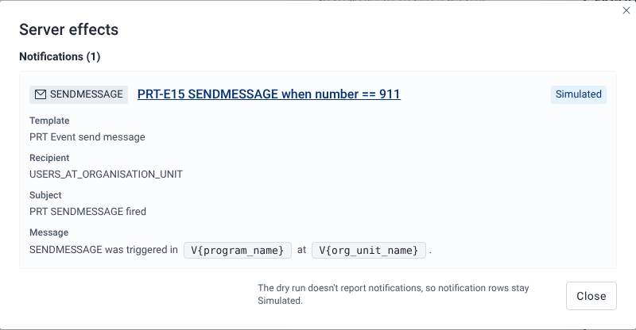

# Preview server effects

## Goal

See what the DHIS2 server would do when this form is saved: the notifications it would send or schedule, and the events it would schedule. Some rule actions only run on the server, so the form itself never shows them. **Preview server effects** lists them in a read-only dialog called **Server effects**. Nothing is sent.

## Before you start

- Open a program and a form. **Preview server effects** works without an organisation unit.
- To compare the preview with the server, run [Verify with server](./check-rules-against-the-server.md) first.

## Steps

1. Fill in the form so the rules you want to test fire.
2. Select **Preview server effects**. In a tracker program it is on the Enrollment form and on every stage form.
3. Read the **Server effects** dialog.
4. Select a rule name to open its details.
5. Select **Close** to return to the form.

## What you'll see

The dialog loads the server-side actions of the program's rules, showing "Loading server-side actions…" while it works. It then lists what fired in the latest evaluation of the form, in up to three sections:

- **Notifications (n)**: one row per **SENDMESSAGE** or **SCHEDULEMESSAGE** action. A row shows the **Template**, **Recipient**, **Delivery channels**, **Subject** and **Message**. A scheduled message also shows **Scheduled for**, the date the rule worked out. If that date isn't a valid date, the row adds the tag "Invalid date, server will skip". In the subject and message, placeholders that point at a field with a value are filled in from the form, including Enrollment form attributes when you preview a stage form. Placeholders the app can't fill in, such as `V{program_name}`, stay as code. If the template is missing, the row says "Notification template not found for this action."
- **Events (n)**: one row per **SCHEDULEEVENT** or **CREATEEVENT** action, with the **Target stage** and **Due date**.
- **Server validation (n)**: after a [Verify with server](./check-rules-against-the-server.md) run, the rule errors, warnings and assigned-value overwrites the server reported. Each row shows the level (**Error**, **Warning** or **Assign overwrite**), the rule and "field: message".

If nothing server-side fired, the dialog says "No server-side rule effects fired."

Each row names its rule. Select the name to open the rule's details.

### Provenance tags

The tag on the right of each row says where the row comes from:

| Tag | Meaning |
| --- | --- |
| **Simulated** | The playground worked this out in your browser. There is no server result to compare it with. |
| **Server-verified** | Your browser and the server's dry run both produced it. |
| **Server only** | The server's dry run reported it, but the playground didn't produce it. |

A row that the server you are connected to would not run is dashed and dimmed, with the note "Not executed by this server" or "Not executed by this server (requires 2.43)". See [Provenance tags](../reference/provenance-tags.md).

### Why notifications stay Simulated

The dry run doesn't report notifications. So even after **Verify with server**, notification rows keep the **Simulated** tag. The dialog footer says so: "The dry run doesn't report notifications, so notification rows stay Simulated." Before any dry run, the footer says "Use Verify with server on the form to compare against the server."

:::note

The server runs **SCHEDULEEVENT** on DHIS2 2.43 and later. On DHIS2 2.40 to 2.42, **SCHEDULEEVENT** and **CREATEEVENT** rows show "Not executed by this server (requires 2.43)". On 2.43, **CREATEEVENT** rows show "Not executed by this server", because the server declares the action but doesn't run it.

:::

### Event status

**Preview server effects** previews the form with status `ACTIVE`. To preview what happens when the event is completed, use **Preview on-complete effects**. See [Test on-complete rules](./test-on-complete-rules.md).

## Related pages

- [Check rules against the server](./check-rules-against-the-server.md)
- [Test on-complete rules](./test-on-complete-rules.md)
- [Provenance tags](../reference/provenance-tags.md)
- [Rule action types](../reference/rule-action-types.md)
- [Why client and server results differ](../concepts/why-client-and-server-results-differ.md)
