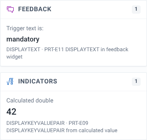

# Read the Feedback and Indicators sidebar

## Goal

Check the text and values that your DISPLAYTEXT and DISPLAYKEYVALUEPAIR rules produce, and see which rule produced each one.

## Before you start

- You have a program open in the playground. See [Find and open a program](./find-and-open-a-program.md).
- The program has rules with a DISPLAYTEXT or DISPLAYKEYVALUEPAIR action. Other action types don't show here.

## Steps

1. Find the sidebar to the right of the form fields. It has two cards, **Feedback** and **Indicators**. The sidebar stays in view as you scroll the form.
2. Enter values that make your display rules fire. Items appear in the cards as soon as a rule fires, and disappear when it stops firing.
3. Read the footer of each item to see which rule action and which rule produced it.

## What you'll see

Each card has a count of its items in the header.

Where an item goes depends on the location set on the rule action:

- **Indicators** shows items from actions whose location is `indicators`, the indicators widget.
- **Feedback** shows items from actions with any other location, such as `feedback`, the feedback widget.

Each item has three lines:

1. The action's static text, in small grey type. For example, "Calculated double".
2. The evaluated value of the action's data expression, in larger type. For example, "42". Indicator values use a larger, number-friendly font.
3. The action type and the rule name, for example "DISPLAYKEYVALUEPAIR · PRT-E09 DISPLAYKEYVALUEPAIR from calculated value".

The rule name in the footer is plain text. Items are not links. To look at the rule, find it by name in the **Rules** tab of the rules panel. See [Find out why a rule did or didn't fire](./find-out-why-a-rule-did-or-didnt-fire.md).

Two actions with the same location and the same static text show as a single item.

When nothing is firing, the cards read "No feedback rules are firing in this form." and "No indicator rules are firing in this form."

In a tracker program, each form has its own sidebar. The **Enrollment form** and each stage or event form only show the items produced in that form.

## Related pages

- [Read field badges and hidden-field placeholders](./read-field-badges-and-hidden-field-placeholders.md)
- [Rule action types](../reference/rule-action-types.md)
- [Find out why a rule did or didn't fire](./find-out-why-a-rule-did-or-didnt-fire.md)
