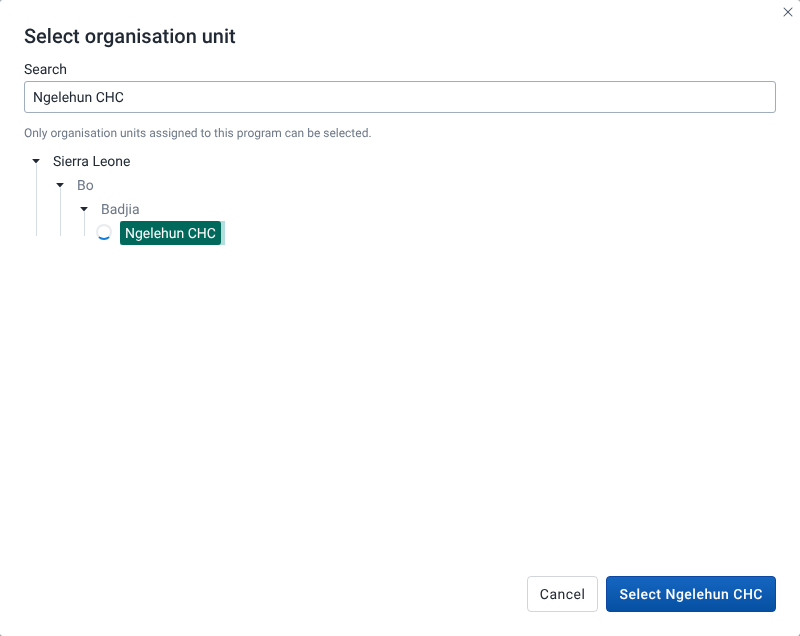

# Set the organisation unit and date

## Goal

Set the organisation unit and the date that the playground uses for the form. Rules can read both, for example through the `V{org_unit}` or `V{event_date}` variables, and **Verify with server** sends them to the server.

## Before you start

- You have opened a program. See [Find and open a program](./find-and-open-a-program.md).
- The program has organisation units assigned, and at least one of them is in your data capture organisation units if you want to use **Verify with server**.

## Steps

### Choose the organisation unit

1. In the context bar at the top of the playground, find **Organisation unit** and select **Select**. Once an organisation unit is set, the button reads **Change**.
2. The **Select organisation unit** dialog opens. It shows a tree of organisation units, starting from your own organisation units.
3. To find an organisation unit, type part of its name in **Search**. The search only looks at organisation units assigned to this program. Matches are highlighted and the tree opens to show them.
4. Select an organisation unit in the tree. Only organisation units assigned to the program can be selected. Others, such as a region above an assigned facility, are greyed out. Hover one to see "Not assigned to this program".
5. Select **Select** followed by the organisation unit name, for example **Select Ngelehun CHC**. To close the dialog without a change, select **Cancel**.

### Set the date

1. Find the date field next to **Organisation unit**. Its label depends on the program:
   - **Event date** for an event program. The playground uses it as the date of the event.
   - **Enrollment date** for a tracker program. The playground uses it as the enrollment date.
2. Pick or type a date. The field starts at today's date.

## What you'll see

The context bar shows the selected organisation unit name in the **Organisation unit** field.

The organisation unit is marked as required, but only **Verify with server** needs one. **Validate form**, **Preview server effects** and **Preview on-complete effects** run without it. If you use any of these buttons with no organisation unit, the field shows "Required to verify or save" as a reminder. **Verify with server** then fails with **Could not verify with server** and "Select an organisation unit before saving or verifying". Nothing is saved in either case, whatever the message says.

In a tracker program, the date only sets the enrollment date. Events you add in stage forms always use today's date, and stage forms have no date field. See [Work with repeatable stages](./work-with-repeatable-stages.md).

The label is always **Enrollment date** or **Event date**. A custom enrollment date label set on the program is not used here.

The organisation unit and date are not remembered. They are empty and today when you open a program, and again after **Reset playground**.

If the program has no organisation units, or they can't be loaded, the playground shows a notice instead of the forms, for example "No organisation units available". See [Troubleshooting and FAQ](../help/troubleshooting-and-faq.md).

## Related pages

- [Check rules against the server](./check-rules-against-the-server.md)
- [Rule inputs](../concepts/rule-inputs.md)
- [Start over](./start-over.md)
- [Troubleshooting and FAQ](../help/troubleshooting-and-faq.md)
