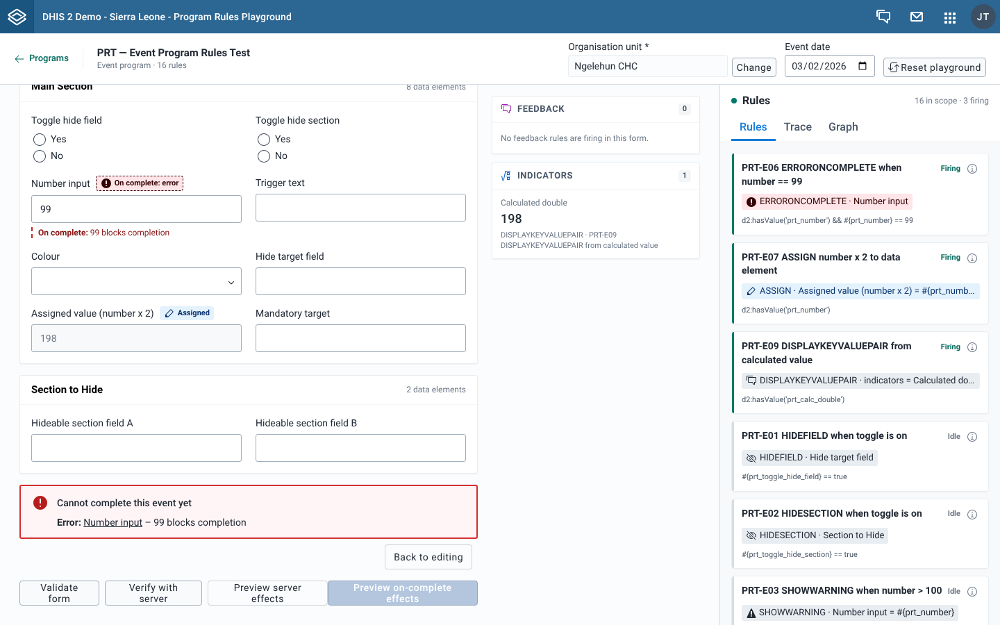

# Test on-complete rules

## Goal

Test the rules that only matter when an event is completed: **ERRORONCOMPLETE**, **WARNINGONCOMPLETE** and required fields. **Preview on-complete effects** runs a completion pass, the same check a data entry app runs before it lets you complete an event. It then shows the server effects for a completed event. Nothing is completed or saved.

## Before you start

- Open an event program form or a stage form in a tracker program. The Enrollment form has no **Preview on-complete effects** button.
- You don't need an organisation unit, unless you also want to run **Verify with server**.

## Steps

1. Fill in the form. A field that a rule flags on completion already shows an **On complete: error** or **On complete: warning** badge.
2. Select **Preview on-complete effects**.
3. If the completion pass finds nothing, the **Server effects** dialog opens for a completed event. See [Preview server effects](./preview-server-effects.md).
4. If it finds issues, read the banner above the form buttons, then choose:
   - **Back to editing** to close the banner and go back to the form.
   - **Complete anyway** to open the **Server effects** dialog for a completed event. This button only appears when nothing blocks completion.
5. To check the completed event with the server too, close the **Server effects** dialog, then select **Verify with server**. After the dialog has been opened for a completed event, **Verify with server** sends the event as completed.

## What you'll see

### The completion pass

The app sets the form's status to completed, waits for the rules to evaluate again, and collects:

- **Error**: an **ERRORONCOMPLETE** action on a visible field, or one with no field.
- **Required**: a visible field that is required, by metadata or by a rule, and is empty.
- **Warning**: a **WARNINGONCOMPLETE** action.

### The completion banner

| Banner | When | Buttons |
| --- | --- | --- |
| **Cannot complete this event yet** | At least one error or empty required field. | **Back to editing** |
| **Review before completing** | Only warnings. | **Back to editing**, **Complete anyway** |

Blocking issues are listed first. Each line reads "Kind: field – message", for example "Error: Number input – 99 blocks completion" or, after you type `mandatory` in **Trigger text** of the PRT event program, "Required: Mandatory target – This field is required". Select the field name to jump to the field. Keyboard focus moves to the banner when it appears.

The banner updates as you fix fields. When the last issue is gone, the banner disappears. While the banner is open, **Preview on-complete effects** is disabled.

### What Complete anyway does

The playground saves nothing, so **Complete anyway** doesn't complete the event. It opens the **Server effects** dialog with the status set to completed, so you can see what the server would do on completion despite the warnings. When you close the dialog, the form goes back to its normal status and the banner closes.

After you have opened the dialog this way, **Verify with server** sends the event with status `COMPLETED` and a completion date, so the server runs its own on-complete checks. Select **Preview server effects** to switch the dry run back to `ACTIVE`.

### On-complete messages on fields

While the form is in completed status, a field with an on-complete message also shows a dashed note under it, "On complete:" followed by the message.

## Related pages

- [Preview server effects](./preview-server-effects.md)
- [Check rules against the server](./check-rules-against-the-server.md)
- [Read field badges and hidden-field placeholders](./read-field-badges-and-hidden-field-placeholders.md)
- [Effect badges legend](../reference/effect-badges-legend.md)
