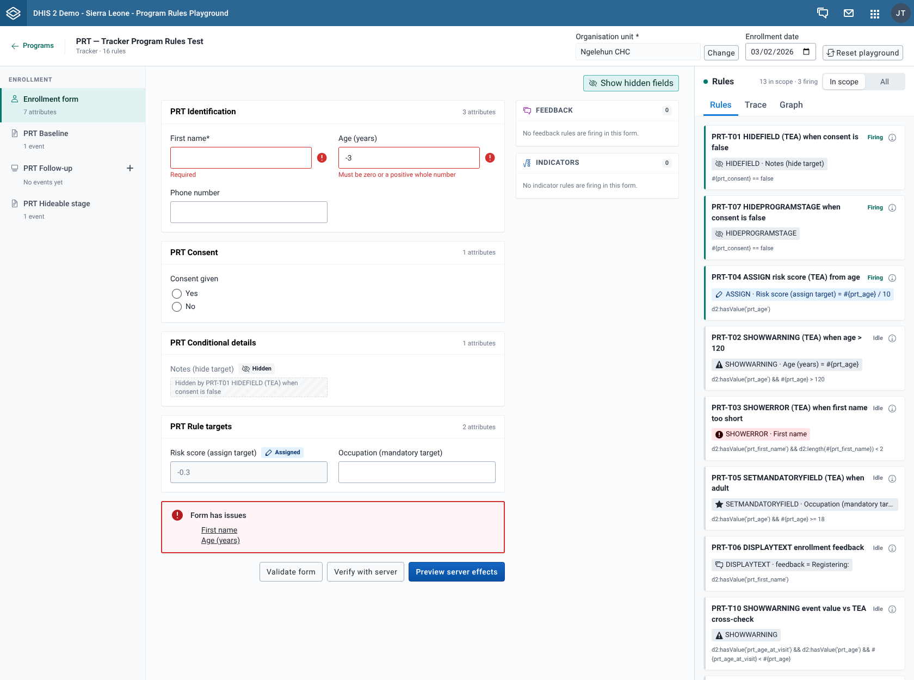

# Validate a form

## Goal

Check the values you entered against the form's own field rules before you test anything against the server. **Validate form** runs in your browser and sends nothing.

## Before you start

- Open a program and the form you want to check. See [Find and open a program](./find-and-open-a-program.md).
- Enter some values. You don't need an organisation unit for this check.

## Steps

1. Fill in the form as you want to test it.
2. Select **Validate form** under the fields.
3. Read the notice that appears above the form buttons.
4. If the notice lists fields, select a field name to jump to it, fix the value, and select **Validate form** again.

## What you'll see

**Validate form** checks every field in the form against its metadata only:

- the value type, for example a number, a date or a phone number
- whether the field is compulsory in the metadata
- whether the value is one of the field's options
- any minimum or maximum the field has

It checks fields that a rule hid, too. It does not use the results of your program rules: a field that shows a rule error (a **SHOWERROR** action) and an empty field that a rule made mandatory (a **SETMANDATORYFIELD** action) don't count as issues. To see those, look at the field badges and the text under each field, see [Read field badges and hidden-field placeholders](./read-field-badges-and-hidden-field-placeholders.md), or check the **Rules** tab of the rules panel, see [Find out why a rule did or didn't fire](./find-out-why-a-rule-did-or-didnt-fire.md).

The form also checks a field when you leave it, so you may see field errors before you select **Validate form**.

The notice shows one of three results:

| Notice | What it means |
| --- | --- |
| **Form is valid**, "No validation issues were found." | Every field passed. |
| **Form has issues** | One or more fields failed a metadata check. The notice lists them by label, each as a link. Selecting a link scrolls to the field and puts the cursor in it. Keyboard focus moves to the notice when it appears. |
| **Could not validate the form** | The check itself failed. The notice shows the error message. |

If you haven't selected an organisation unit, the **Organisation unit** field in the context bar shows "Required to verify or save". This is only a reminder for **Verify with server**. **Validate form** still runs.

## Related pages

- [Check rules against the server](./check-rules-against-the-server.md)
- [Read field badges and hidden-field placeholders](./read-field-badges-and-hidden-field-placeholders.md)
- [Messages and errors](../reference/messages-and-errors.md)
